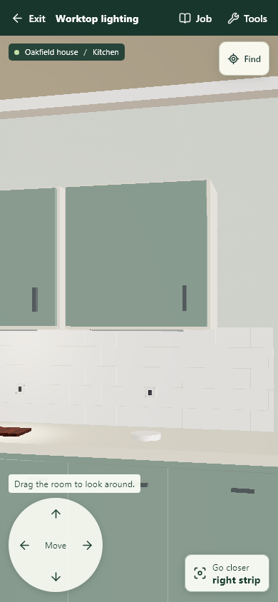

# Irish Electrical Lab on iPhone

Use Safari on iOS 17 or later. The 3D bench uses WebGL 2. If graphics are unavailable, you can still operate equipment, connect wires and take readings through the equipment list. Open the lab, tap **Share**, and choose **Add to Home Screen**. If Safari shows **Open as Web App**, leave it enabled. Tap **Add** and open the new icon. The same lab also works directly in Safari. [Apple’s Home Screen instructions](https://support.apple.com/guide/iphone/open-as-web-app-iphea86e5236/ios)

In the Home Screen app, open **More → Download for offline use**. Keep the app open with a connection until it shows **Offline ready**. The download includes both circuit workers and the simplified 3D equipment for every course and Sandbox. Inspecting equipment loads its full model on demand when available. If the download stops, reopen Settings and help. The count shows how many files are saved. Choose **Resume download** or **Retry offline download** to pick up there. An earlier complete download stays usable while an update is unfinished.

Safari, the Home Screen app, and Windows keep separate study data. On Windows, choose **My builds → Files and backups → Export full backup** and transfer the JSON file to the iPhone’s Files app, for example with iCloud Drive. Open the lab from your Home Screen, then choose **My builds → Files and backups → Restore backup** and pick the file. To export from iPhone, choose **Export full backup**, then **Save to Files** if the share sheet opens. Keep a backup of study data you want to retain. [WebKit storage policy](https://webkit.org/blog/14403/updates-to-storage-policy/)

## Walk around and make a repair

1. Open a job and tap **Walk** or **Full screen**. Tap an arrow to take a short step, or hold it to keep walking. Drag the room to look around. To steer with the same thumb, open **Tools**, turn on **One-thumb walking** and close the tools. The side arrows now turn you. Hold the pad diagonally to walk round a corner. [See the one-thumb controls in the kitchen](images/iphone-one-thumb.png).
2. Face a fitting. A small frame marks the fitting named on **Go closer**. Tap **Go closer** to bring it within reach. For a plan of the building, tap **Find → Room map**. Pick a room on the plan or under **Room on map**. **Go to** takes you there. **Fittings here** takes you straight to the item you choose. **Back to list** lets you search by name or drawing reference. In a close-up, tap **Zoom** to double the size of the fitting. Pinch to adjust it or tap **1×** to get the whole fitting back. Tap **Walk** to step back into the room.
3. Tap **Tools** for the meter, workbench, drawing or equipment list. **Job** opens and closes your instructions. You can hide the sheet to touch a meter point, then bring it back to record the reading. Your probes stay in place. In full screen, **Put meter away** takes you back to the site.
4. For a repair, choose **Chapters → The heater stays cold**. Use the virtual bench meter to find where the feed stops. After diagnosis, tap **Find repair on site**. Switch off the simulated supply and open the wall fitting. Tap a terminal for the loose brown wire, or tap **Reconnect flex** to choose its marking from a list. Turn the supply back on. With the new panel heater, work the wall switch and check that element power falls to zero and comes back. Tap **Test the repair** to finish.



To try the board, open **Chapters → Jobs at Oakfield house → Find the lighting breaker**. The board is in the **Utility cupboard**, the lamp is in the **Entrance hall** and the socket is in the **Kitchen**. Tap **Show the two breakers** in the job if you want a close-up. Tap a lever or use the matching button in **Job**. The readings beside the instructions come from the same circuit. [See the room map with the utility cupboard selected](images/oakfield-room-map.png).

For the two-door bell job, walk through the house or around it by the side passage. Tap a door button once to hold it for a reading and again to let go. The short message at the top tells you which call reached the hall chime. Turn **Doorbell sounds** off in **Tools** if you prefer. [See the front entrance in full screen](images/oakfield-front-door.png). To trace a broken call wire, open **Chapters → The back doorbell is quiet**.

In the stairs job, **Room on map → First-floor landing** opens the upstairs plan. Choose **Go to First-floor landing** to go up, or pick **Stair hall** to go back downstairs. A visit gets you to the fitting. Operating it or taking the requested reading moves the lesson on.

**Exit** brings back the regular layout. Turn your phone sideways for a wider room view. Launching the Home Screen icon gives the lab the space normally used by Safari’s controls. [See the heater switch at 2× zoom](images/kitchen-heater-repair.png).

In **Site**, tap **Go to** and choose a fitting or a room. Use the direction pad to walk and drag to look around. At the stairs, tap the wall switch when you reach it. **Finish walk** returns to the usual site controls. Oakfield’s **Drawing** starts with the room you’re working in. Choose **Whole house** to see how the rooms connect. Tap an equipment tag, then **Find on site**, to visit it.

On the workbench, drag to orbit, pinch to zoom and drag with two fingers to pan. To move a part in Sandbox, select it, tap **Move**, then drag its housing. **Connect** and **Measure** accept taps on the workbench and let you search for terminals by name. Tap a wire to see **Remove conductor**, or find it by name under **View**. Use **Undo** to restore the last edit.

Open **Start learning** for the first light-switch lesson. **Continue learning** brings you back to the saved activity. **Chapters** lists every lesson, Quick practice and the chapter practicals. In an experiment you can predict the outcome or choose **I’m not sure** and try the real control.

**Equipment list** gives you the same controls and terminals by name. Use it when a part is hard to tap or the 3D view cannot start. **Connect → Cable** shows the shapes and cores of the available cable choices. In a meter exercise, pick the red and black probe points, then choose **Record reading**. A full backup includes your current coursebook position as well as the working circuit.

## Build and publish

From `lab/`, after installing the locked dependencies:

```powershell
npm run web:build
npm run web:audit
npm run web:preview
```

Preview at `http://127.0.0.1:4174/irish-electrical-lab/` on the build computer. Localhost is allowed to register a service worker; an iPhone needs the HTTPS deployment URL. The web build writes `lab/dist-web`, with its own iOS 17 build target and repository path. The Windows production build still writes `lab/dist/client` and uses its existing localhost storage origin.

The public repository’s Pages settings must use **GitHub Actions** as the publishing source. Run **Publish iPhone web app** from the default branch after verification. The workflow publishes only `lab/dist-web` under the repository path. The generated service worker verifies the built files by size and SHA-256 and replaces an earlier offline copy only after the required files are available. [GitHub Pages publishing](https://docs.github.com/en/pages/getting-started-with-github-pages/using-custom-workflows-with-github-pages)
