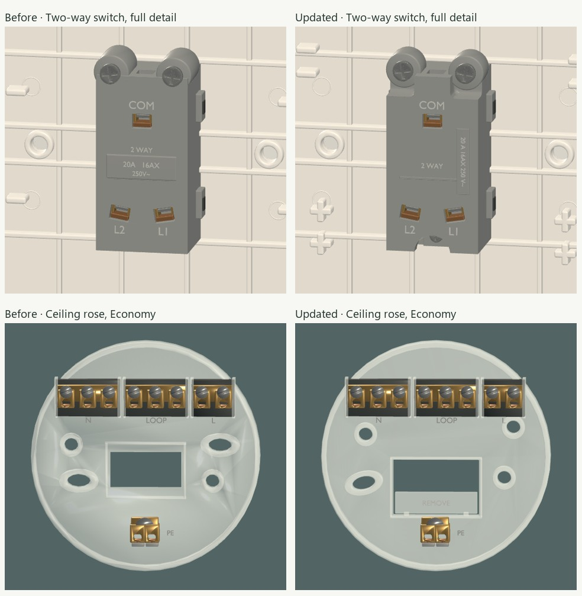

# Verification summary

## 1.7.0 fittings, wiring and house jobs

**Courses and fault finding.** All 340 source tests passed. All 80 working circuits and their 80 set faults were exercised. The teaching audit checked 240 operating steps and 1,382 electrical results across the supply settings. The six-stage index retained all 2,471 exercises. In a full one-way build, each correct wire advanced the instruction. A seventh wire from outgoing neutral to earth failed the protective check. Undoing that wire and retesting passed. Independent probe placement at the lamp gave 240 V. Opening the switch dropped the reading across the lamp to zero.

**Learning and controls.** The three house jobs ran in phone-sized and desktop Chrome and WebKit on Windows. The stair job reopened at the second switch with the first switch still in its previous position. At the board the lamp lost power while the socket kept its supply. A named terminal, the first end of a wire and an actual meter reading were exercised through the UI. Keyboard, mouse and touch runs covered the first build. The short landscape layout was also tested at 200% text.

**Fittings and sites.** Fronts, backs and picking were checked on the BG wall switches and ceiling rose, the five protection devices and the fork tester. A selected terminal stayed with its conductor when a fitting was inspected. All 1,110 conductors in the 80 reference circuits passed the routing check. An installed socket circuit was followed through Oakfield in the plan and in the rooms. The floor plan and visible fittings use the same positions. The plans are original examples. The equipment sources in the authoring directory distinguish photographed features, published dimensions and simplified internals.

The two-way switch now shows the lower screw tucked into its moulded recess. On the rose, the open cable entry and the unopened knockout are separate features.



**Meter and lesson wording.** The doorbell lesson uses the tester’s V setting for both AC readings. The high-water exercise describes the two lights actually wired on that bench. Its fault leaves the warning light dark. The proximity-sensor question asks whether the indicator lights when metal approaches. Trade names printed on equipment are retained beside a plain explanation.

**Rendering on this PC.** The benchmark moved the camera in desktop Chrome on Windows 11 with a Ryzen 7 5700X and GeForce RTX 5070 Ti. The smaller bench had 30 fittings and 42 wires. The process plant had 80 fittings and 228 wires. Every model and wire picking target was present in both sizes. Camera movement and a 2.4-second idle check sent no worker requests. Machinery continued to animate in the running plant.

| View and circuit | Mean frames/s while moving | 95th-percentile frame | Route worker round trip | Median supply click to new result |
| --- | ---: | ---: | ---: | ---: |
| 1440 × 900 desktop, 30 fittings | 149 | 9.1 ms | 205 ms | 16 ms |
| 1440 × 900 desktop, 80 fittings | 45 | 27.7 ms | 2,534 ms | 303 ms |
| 390 × 844 touch emulation, 30 fittings | 220 | 6.0 ms | 177 ms | 14 ms |
| 390 × 844 touch emulation, 80 fittings | 51 | 24.7 ms | 2,159 ms | 306 ms |

These headless browser measurements use the PC GPU. The large plant falls below 60 frames per second during camera movement. Inspected fittings keep their detail when Auto reduces the drawing resolution.

**Wire routing under load.** The actual worker routed all 228 plant wires in 12.38 seconds with scheduling delays deliberately injected. The app kept it running as it reported progress through the search. A separate stalled worker repeating the same checkpoint was stopped after 8.03 seconds. Recovery restored all 42 selectable wires in that test.

**Offline and saved work.** Windows Chromium and WebKit each downloaded the complete pack after an interrupted download. Closing the static server, reopening the app, opening a previously unvisited PLC lesson and importing the large plant exercised both workers offline. The saved plant reopened with all 228 connections and zero requests to the origin. The release pack is about 41.5 MiB. A separate failed-update test retained the preceding working cache.

**Windows replacement.** The per-user installer replaced 1.6.0 with 1.7.0 on this PC. The Desktop and Start menu shortcuts both pointed to the installed executable. An upgrade check on a disposable profile retained the draft, named build and progress at the existing origin. The installed lifecycle check covered a second launch, shutdown and remembered window size after restart. Verification runs use their own profile in the temporary directory.

The final installation matched all 375 packaged web assets. Its worker returned results for all 80 circuits with zero remote requests. The graphics driver reported one warning for a successfully linked antialiasing shader. In a separate single launch with a fresh temporary profile, the installed renderer reached the site canvas and drew two frames in 1.72 seconds. The matching Electron runtime used 482 MiB of working memory across its processes 1.3 seconds later.

**What still needs people.** These are software and browser observations. A physical iPhone test, a session with a first-time learner and a qualified electrician’s review of the installations are still outstanding.

## 1.6.0 coursebook and fittings

**Course checks.** All 317 source tests passed. The catalog check covered 80 courses and 109 equipment variants. The simulation audit ran each working example and its fault. The teaching audit covered 2,471 activities, 240 operating steps and 1,382 electrical checks across the supply presets. All 1,110 example wires found routes with clearance.

**Learning through the interface.** An automated learner used the real buttons, keyboard, equipment list, workers and local saves to complete all ten lighting courses. The run covered 96 activities, including 16 wire placements and 20 independently placed probe endpoints. The two-way switching practical passed its 28 checks. Returning to the opening course restored the step and the open switch. The EV fault exercise required readings at the controller and charger, an accepted diagnosis, a repair and a fresh test. An ordinary fault exercise and a scored one with a hint both completed.

**Fittings.** The wall switches, rose, lamp holder, socket, fused outlet and isolated shaver fitting were checked against manufacturer photographs and drawings. Full and reduced assets were checked for selection and terminal alignment. Picking the back of the switch and choosing the same detail by keyboard displayed the correct explanation. Inspections and electrical tests included the permanent loop, the double socket's two earth entries and the shaver output's isolation. Rendered geometry is an original reconstruction. Several small dimensions and concealed mechanisms are inferred from the available views.

**Windows.** The replacement installer updated the existing 1.5.0 installation. Both shortcuts point at 1.6.0. All 362 installed web files, the executable and the application shell matched the production build. An upgrade rehearsal held the app origin constant and verified that the draft, named build and progress survived in a disposable profile. On this PC a fresh Electron profile reached the installed Site canvas plus two frames in 1.52 seconds and used 463 MiB across processes at the sample point.

**Rendering.** In desktop Chrome on the RTX 5070 Ti, a 30-component, 42-wire bench at 1440 × 900 had a median frame interval of 4.5 ms during mouse camera movement and a 95th percentile of 6.5 ms. During a three-second idle check it issued zero renders and zero worker requests. Eight electrical edits took a median of 4.25 ms for the calculation and 11.5 ms round trip.

**Mobile and offline.** Touch-emulated Chromium at 390 × 844 and 844 × 390 exercised the production app. A forced graphics interruption restored the lesson and switch position. The offline download recovered from an interrupted file and verified all 237 application, equipment and scene files (42.8 MiB). With its server stopped, the app opened a previously unvisited PLC lesson, routed and solved the 80-piece, 228-wire plant, saved the draft and reopened it. It made zero requests to the origin. A backup also travelled from a desktop-sized profile to a phone-sized profile and back, retaining the circuit, switch position, named build, learning history and place in the lesson.

**Field checks still outstanding.** No independent learner, apprentice or qualified electrician participated in these tests. Physical iPhone Safari, Home Screen installation, the iOS Files picker, and comparison with an actual meter still need hands-on checks.

## 1.5.0 installation lab

**Lessons and equipment.** All 80 examples passed their operating sequences and authored fault checks. The teaching audit exercised 2,471 activities, 240 operating steps and 1,382 electrical checks. The 68 single-phase examples were checked at 230 and 240 V, and the 12 three-phase examples at 400 V between phases. The source suite passed 302 tests, with another 46 passing in the independent authoring simulator.

**On the bench.** Keyboard controls took the two-push doorbell lesson through its guided stages, including separate front and rear calls and a 12 V AC measurement. In the tunable-white lighting lesson, moving the control through its range gave warm/cool branch powers of 12/0, 6/6 and 0/12 W. The isolated supply measured 24 V DC. A broken warm branch gave OL on the isolated resistance test. A measured diagnosis, repair and fresh 30-of-30 retest completed the exercise. Site interaction tests clicked the actual wall switch and cupboard door, checked the resulting circuit states and confirmed that a camera drag over a control left it alone.

**Model and drawing review.** The library covers 108 original Blender variants with full and reduced exports, including 21 additions. All 80 site views were rendered and reviewed. The Gamma and Invicta assemblies were checked with doors open and closed, fronts removed and devices mounted. Detaching the board bond produced the expected protective finding. Clearance checks covered 1,110 conductors across the course examples. The diagrams and named controls retain the same component and terminal identifiers as the circuit.

**Windows.** A 30-component, 42-wire bench at 1440 × 900 on an RTX 5070 Ti rendered 1,505 frames during 6.53 seconds of mouse camera movement. The 95th-percentile frame interval was 5.6 ms. Over three seconds idle it issued zero renders or worker requests. Eight electrical edits took a median of 4.75 ms in the worker and 13.25 ms round trip. The packaged site reached its canvas plus two frames in 1.82 seconds in a fresh Electron profile. The combined process working set sampled shortly afterwards was 451 MiB. These are single-machine renderer and process measurements.

**Upgrade and offline use.** The 1.5.0 installer replaced the 1.2.1 installation on the test PC. Desktop and Start menu shortcuts both pointed to 1.5.0. All 351 installed web assets, the executable and the application shell matched the build hashes. Separate upgrade rehearsals at the desktop storage origin retained the draft, named build and progress from 1.2.1 and 1.4.0 in disposable profiles. A study backup also made a round trip across three browser profiles using desktop and phone-sized layouts.

In touch-emulated Chromium, the 37.8 MiB offline pack recovered from an interrupted download and verified all 227 files. With the server stopped and the browser offline, a cold launch loaded a previously unopened PLC course with 35 conductors. The Sandbox then imported, solved, saved and reopened the 80-component, 228-wire plant. The successful run recorded zero requests to the origin and zero renderer errors.

**Field validation.** Phone interaction used Chromium touch emulation. Physical iPhone Safari, Home Screen and Files behaviour, comparison with a calibrated tester, and observation by a qualified electrician or first-time learner still need in-person checks. Manufacturer sources document the equipment references. The simulation describes its steady-state and instrument assumptions in the app.

## 1.4.0 coursebook and workbench

The curriculum audit covered all eight chapters, all 64 electrical scenarios and fault targets, 196 operating steps and 1,058 electrical checks. Every one of the 2,021 original six-stage activities retained its ID. A separate test checks each coursebook question, prepared build, chapter practical and the boundary between assisted and independent meter readings.

The production browser completed the ten Lighting courses in sequence with 3D disabled and keyboard-accessible controls. It traversed all 96 activities, retained 75 demonstrated achievements, added the 16 missing conductors, and selected 20 independent probe points. Each named next-lesson action led to its intended course. The two-way switching practical began unwired and passed all 28 final report checks. A new lesson resets the active probe to red so the next measurement can begin straight away.

In a disposable browser profile, keyboard input completed the first switch lesson and independently recorded 239.96 V. Quick practice accepted an unsure prediction and a subsequent observed change from 240 V to zero. On the dimmer bench, lamp power rose from 3.7 W at 25% to 48.6 W at 90%. Searching for a motor that stays on after Start led directly to the unwired practical. Separate profiles with desktop and phone-size viewports transferred a named build, circuit revision, study history and precise coursebook activity through two full backup restores.

With WebGL disabled, keyboard input through the equipment list completed a fault exercise and a fresh retest. An extra connection from RCBO outgoing neutral to the lamp’s protective earth produced a specific finding. The test selected that conductor, undid the edit, reset the tripped protection and retested. Ordinary practice accepted help without a score. The separately selected scored challenge recorded 85/100 after one hint. Browser layouts were exercised at 320 and 390 CSS pixels in portrait and 844 in landscape, including enlarged text.

The model review covered both detail levels and the service view of all 87 variants. Geometry checks exercise the actual access direction to enclosed terminals. The renderer’s clearance tests cover 931 course connections and the 228-wire integrated process plant. The 3D mouse test added all six one-way lighting conductors and all 18 shutter-control conductors, checking that each correct wire advanced exactly one activity. The editable sources were decompressed and checked for personal workstation paths.

**Windows GPU benchmark.** At 1440 × 900, headless Chromium used an NVIDIA RTX 5070 Ti through Direct3D 11. The 30-component bench routed 42 conductors in 116.5 ms. During real mouse camera movement the renderer issued 1,377 frames in 6.53 seconds (211 renderer frames/second, 95th-percentile interval 6.3 ms). These figures measure rendering, not monitor presentation. Over 3.01 seconds at rest there were zero renders or worker requests. Eight electrical edits had median worker calculation time of 4.2 ms and median round trip of 11.9 ms.

**Offline browser.** The installation pack contains 185 verified files (35.1 MiB). During a forced interruption the download offered Retry. With the origin server shut down and networking disabled, a cold launch loaded the previously unopened PLC lesson and all 35 wires. The 80-component process plant routed all 228 wires, saved, and reopened. On Windows Chromium at 390 × 844 with software WebGL, file selection through routing and two rendered frames took 6.7–7.8 seconds across two runs. The last solves took 786–900 ms. The two render samples read 6 and 7 fps. Physical phone and GPU timings can differ.

**Windows delivery.** The source suite passed 280 tests plus 46 independent authoring simulator tests. The Windows x64 release uses Electron 44.9.1, which includes the [upstream certificate-trust fix](https://github.com/advisories/GHSA-jr5w-w6x2-84p9). The setup contains the offline production renderer, both workers, models, guides and notices. Upgrade retention was exercised with renderers extracted from the 1.3.0 and 1.4.0 installers at the desktop storage origin in a disposable Electron profile. The existing draft, named build and progress survived. The live Windows study profile was outside this test.

**Human and device observations.** These are automated electrical and interaction results. No first-time learner, apprentice or qualified electrician participated in this verification. Physical iPhone Safari, Home Screen installation, Files transfer and physical-device performance still require direct observation.

## 1.3.0 iPhone and Quick practice

- Type checking, 263 source tests and the catalog, operating scenario and teaching audits passed across all 64 courses. The audits cover 2,021 existing activities. The experiment tests use actual simulation results, including the timer run-on and holding contact sequences.
- The web artifact audit served the project subpath, verified all 87 equipment variants and exercised both emitted workers. It verified all 185 offline files, download retry, and keeping an earlier offline copy when an update fails.
- Chromium touch emulation at 320 and 390 pixels in portrait and 844 pixels in landscape passed without horizontal page overflow. The browser reopened the app offline, loaded an equipment model that had not been opened, completed the live one-way experiment (240 V to 0 V), and advanced guided wiring after a correct named-terminal connection.
- The Windows x64 installer builds with 287 bundled web assets and both workers. The renderers extracted from the 1.2.1 and 1.3.0 installers were exercised at the desktop origin in a disposable Electron profile. The draft, named build and progress were retained. This test did not run an in-place NSIS installation on the learner's profile.
- Safari, Home Screen installation, Files dialogs, and performance on a physical iPhone require device testing. Chromium checks do not measure phone performance.

## 1.2.1 Windows release

The installed Windows release is **1.2.1**. This curated summary contains no learner profiles or raw database recovery files. Raw local evidence remains outside Git in the workspace's ignored `verification` directory.

The guided wiring repair passes **249 source tests**, type checking, targeted changed-module lint and the production build. Source cases cover all 64 courses and their 931 connection steps, both endpoint orders, correct control-wire identification, deliberate identification overrides, duplicates and stale additions.

The final installed app passes **120 focused native checks**. Actual mouse input completes the six lighting and eighteen shutter-control connections without manual Check/Next. Each correct addition credits exactly one activity; wrong endpoints and explicit wrong identities do not advance. Settings renders, stage navigation, Undo/Redo and reload do not replay awards. Every original profile key and native window state is restored exactly after these tests.

All **64 configurations** converge through the actual packaged calculation and routing workers: **931 routed paths**, zero routing issues, console errors or remote requests. The installer matches all 287 bundled web assets and the desktop shell. Actual replacement installation retains saved work, Desktop and Start menu shortcuts, and the stable local origin. The server stops when the app closes.

The previous graphics release also passed its original Blender asset and native gallery audits for **87 equipment variants**. Those gallery and frame-rate observations were not repeated for this focused repair. Source files and original models are included; generated installers, runtime copies, downloaded Blender and private recovery artifacts are excluded from Git.

Run the source tests from `lab` with Node and installed dependencies:

```powershell
node --import tsx --test scripts/*.test.ts scripts/*.test.tsx scripts/*.test.mjs
node node_modules/typescript/bin/tsc --noEmit
npm run build
```

The app-owned `--verify-guided-build` and `--verify-desktop` diagnostics check the actual Windows application. Read the desktop guide before deliberately running profile-restoring verification modes.

## Public release preparation

The complete source suite was rerun for publication: **249 tests passed**, with
type checking and changed-script lint. Packaging now generates its QA fixtures
from the source instead of depending on an ignored local file. The regenerated
catalog routing audit passes **931 of 931 paths**. The production build, offline
asset audit and actual emitted calculation-worker audit pass after asset cleanup.

All **88 source PNGs** were audited. Text metadata was removed from 87 thumbnails;
all image-data, critical and retained-chunk hashes remained identical. The icon
was already clean. Blender exports now perform the same sanitization, with five
regression checks. Profile records, raw recovery evidence, downloaded tools and
generated runtime directories remain excluded from the public repository.

The original process-plant example has **80 components, 228 wires, 32 passing
source checks**, zero route-clearance issues and a maximum of **340 solver
unknowns** across its checked scenarios. Native Windows file-dialog import and
named-build saving succeeded. Its actual in-app electrical test passed with no
reported protective defect; course operating objectives correctly remain
unassigned for this free build. The source operating checks are distinct from
that native electrical report.

Native mouse operation also reset the process safety permission and pulsed the
conveyor START control. After the momentary button released, the selected
contactor still reported **Operating**, with **23.9 V across its coil**. This
demonstrates the actual custom holding path in the installed app.

The public installer was rebuilt from the reviewed source and sanitized assets.
Its unpacked resources contain **303 files**; all **287 web assets** match the
production build. Project/dependency notices, the usage guide and the demo JSON
match their source copies. No current-user name/profile-path marker was found
in those resources, and the desktop shell archive contains neither learner
profiles nor a runtime `node_modules` tree. The compiled setup executable is
**130,546,212 bytes**; its checksum is supplied with the release download.

The public-source index audit covers **736 files**, with zero credential,
current-user name/path or excluded-artifact findings. These checks describe the
publication set, not raw private verification files. Existing native release
behaviour and this session's demo interactions were inspected in the installed
application; replacement installation was not repeated for attribution-only
packaging changes.
