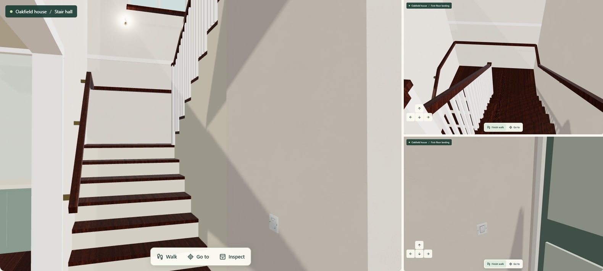
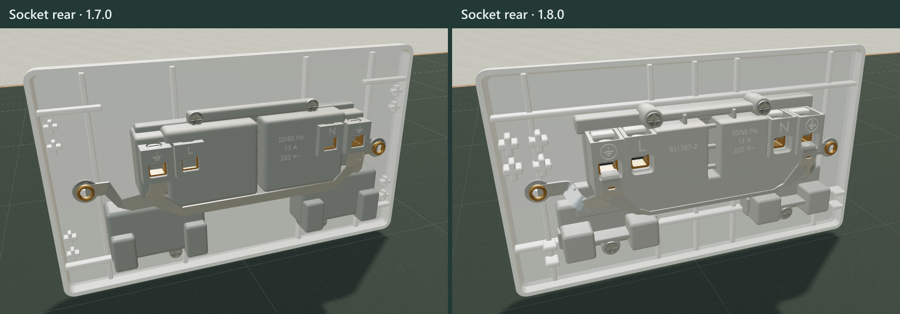

# Verification summary

## 1.21.0 — Take the meter to the fitting

**Opening the job on a small phone.** We opened the heater repair at 320 × 568 with its instructions expanded. In 1.20.0 the canvas was only 44 px high and its controls covered the room. In the revised layout, 194 px of the room remained clear in touch WebKit. With text enlarged to 150%, the clear height was 177 px in WebKit and 176 px in Chromium. We operated the wall switch, followed the next instruction, switched to the drawing and back, and entered full screen. The full job title, first action, supply switch and circuit test stayed reachable.

**Taking a reading in full screen.** In the worktop lighting repair, we put the probes on the dark strip and recorded 0 V. We then picked the other strip by name and measured 24 V DC. On the doorbell, we opened the chime cover and recorded 12 V AC. Moving a probe to an unused contact gave dashes and disabled Record. Putting the meter away restored the original walking position and direction. At 390 × 844, the worktop scene retained 729 px of height above the meter. At 844 × 390 it retained 275 px. The 320 × 568 Chromium run with 150% text retained 381 px, and every meter button measured at least 44 px high.

**At the wall switch.** In a fresh 390 × 844 touch WebKit session on Windows, we opened **The heater stays cold** and chose **Full screen → Tools → Check wall switch**. The fitted plate stayed closed until the simulated supply was off. We tapped the metal screws for L IN and L LOAD. The display showed OL with the switch off and 0 Ω with it on. Recording the reading kept the job at **Measure**. Refitting the plate removed the two probes at the switch. Returning to the training bench restored the probes we had placed on the heater. [View the actual probe tip and meter display](images/wall-switch-meter.png).

**Finding and repairing the fault.** On the 240 V study supply, we recorded 0 V across the heater. Choosing incoming L at the wall switch gave 240 V and a prompt to check its LOAD side. Recording 240 V at LOAD L, with the other probe still on heater N, opened the diagnosis. Trying a different diagnosis and then the wrong screw at the repair both left the job open. After repair the element drew 498 W, fell to 0 W with the switch off and returned to 498 W when switched on again. A fresh test completed the job. We repeated the repair at 1280 px using the equipment list and keyboard in Chromium.

**Saved jobs.** We resumed a 1.20.0 job with its first reading and both probe positions intact. A second run resumed a 1.17.0 repair on the original 300 W heater, with its earlier completion requirements. The focused regression checks also covered the older separate-fuse circuit, reversed probe colours, stale readings and other pairs of points that can show the same voltage.

**Course coverage.** All 484 automated tests passed. The catalogue and simulation checks covered 80 operating scenarios, 80 fault targets, 2,485 course activities, 115 equipment variants and 1,119 routed wires.

**Offline repair.** A fresh touch WebKit session verified all 259 offline files (50,462,798 bytes). We stopped the origin server, closed the app pages and reopened the lab. A previously unvisited heater job loaded the simplified wall fitting. Two taps on its metal screw heads gave 0.001 Ω with the rocker on, displayed as 0 Ω, and OL with it off. Both manually recorded readings survived another close and reopen. The workbench routed all eight wires offline. The run had zero page errors and zero HTTP responses from the stopped origin. The WebKit check reopened pages in one browser session.

**Restart coverage.** Chrome also loaded the unvisited heater and retained both readings across two complete browser-process restarts with the server stopped. On this PC even a standalone cache-write test failed in the WebKit automation runner's persistent profile, so its full-process restart remains unverified.

**Windows replacement.** The 1.21.0 installer retained all five study records from a 1.20.0 disposable profile with matching hashes. The desktop and Start menu shortcuts, shutdown and restart checks passed. The installed app ran all 80 circuits and passed 120 guided-build checks with zero external requests and zero console errors. The graphics driver reported one shader warning. On this PC the window started in 0.99 s, geometry appeared 5.10 s after launch and the app used 566 MiB of private process memory at the measured checkpoint.

**Workbench performance on Windows.** In headless Chrome on an RTX 5070 Ti, panning the 30-component bench averaged 4.01 ms between frames, with 95% at or below 4.4 ms. The three-second idle sample used zero frames and made zero worker requests. All 42 wires routed, with no route findings. Eight supply edits had median solver time 4.2 ms and median worker round trip 16.05 ms.

**Phone coverage.** These touch results used WebKit and Chromium on Windows. A physical iPhone check would include reading the screw markings in portrait, turning the phone sideways with both probe tips placed and reopening the saved job from the Home Screen.

## 1.20.0 — Find the lighting breaker

**Course and electrical checks.** The job runs against course 2’s actual lamp and socket. Automated checks swapped the two outgoing feeds and verified that credit followed the circuit which lost power. The shared switch disconnected both loads. Both drew zero current, and the solver could no longer resolve a voltage across either one. A trip from the RCCB test button and the subsequent reset earned no credit for moving the shared lever off and on.

**Learner walkthrough.** Headless Chromium at 1280 px completed the job with keyboard controls. Touch-enabled WebKit ran it in portrait at 320 × 844 with 150% text and in landscape at 844 × 390. Checks included choosing the wrong breaker, interpreting the wrong reading and reopening the job with the shared switch off. On the 240 V study supply the final readings were 239.8 V at the lamp and socket.

**Room map.** Touch-enabled Chromium and WebKit opened the map, showed the walker’s position and visited the entrance hall. Cancelling the map left the camera at its previous position. From the hall, the utility cupboard’s list opened the consumer unit close-up. Further 390 px WebKit walks reached the first-floor landing and returned downstairs (course 9), visited the side passage and rear bell push (72), and reached Goods receiving, its emergency fitting and the service yard (44). The walking arrow matched the camera’s location and direction. The close-up marker matched the fitting’s position in each case. Visiting those rooms and fittings left awards and the current lesson step unchanged. A fresh WebKit run captured the map shown in the phone guide. [View the selected room and the walker’s marker](images/oakfield-room-map.png).

**Full-screen controls and repairs.** In touch WebKit, a tap on the walking pad moved 0.25 m. With one-thumb walking enabled, a side tap turned the view 15°. The canvas occupied 390 × 794 pixels in portrait and 844 × 340 in landscape. In the doorbell repair we followed the failed rear call, rejected the wrong screw, repaired the connection with the simulated supply off and needed a fresh test to finish. On the board, an open cover gave access to both levers and the blue T button. Closing it blocked the controls behind it. The trip flag changed on a powered test. The same button with the supply off left the contacts closed. At 320 × 844 with 150% text, all seven board responses fit in a full-width row beneath the controls without splitting words.

**Offline and regression checks.** A fresh WebKit profile verified the hashes of all 259 offline files (50,438,575 bytes). After shutting down the server, we reopened the app, loaded the board job, used the map and visited the consumer unit. All 481 automated checks passed, including reset into a persistent fault. The catalogue checks covered 80 operating scenarios and 80 fault targets, 2,485 activities, 115 equipment variants and all 1,119 routed wires.

**Measured on Windows.** Chrome on an RTX 5070 Ti rendered a 30-component, 42-wire workbench at 1440 × 900. Camera motion averaged 4.22 ms between frames, with 95% of intervals at or below 5.30 ms. The three-second idle sample recorded zero frames and zero solver or routing requests. Across eight supply edits, median solver time was 3.80 ms and the median worker round trip was 15.85 ms.

**Windows replacement.** The installed 1.20.0 app reopened all five seeded study records from 1.19.0 with matching hashes in a disposable profile. Both shortcuts worked, as did shutdown and restart. The installed app ran 80 circuits and passed 120 guided-build checks without external requests or console errors. The graphics driver logged one shader warning. The window took 1.01 seconds to start and the workbench geometry was ready 5.12 seconds after launch. The app processes held 553 MiB of private memory at the measured checkpoint.

**Earlier study data.** A full backup exported by the 1.19.0 web app was restored in the new build on a fresh origin. The original completion and both lighting activities were retained. The learner could then take the new socket and shared-switch checks.

**Updating a phone-sized offline copy.** In touch Chromium and Windows WebKit, we interrupted the 1.19.0 → 1.20.0 download during a breaker model update. The previous offline pack and open job still worked. After a successful retry, closing the last lab tab activated the new pack. We stopped the server, opened the new room map, walked to the kitchen and resumed the saved job. The draft, named build, learning history and bookmark all matched.

**Physical iPhone.** The mobile results above are WebKit emulation. For a device check, open the Home Screen app in portrait, visit the utility cupboard through **Find → Room map**, operate both breakers, turn the phone sideways and finish the shared-switch check. Reopen the job and verify that its saved place is still there.

## 1.19.0 — Find your way around Oakfield

**Phone controls.** In touch Chromium and Windows WebKit the full-screen site occupied 390 × 794 pixels on a 390 × 844 portrait viewport and 844 × 340 in landscape. We searched for a fitting, zoomed in, walked, steered with one thumb and returned to the same viewpoint after opening the drawing. At 150% text, the site meter controls remained visible and at least 44 pixels tall on 320 × 844 and 844 × 390 screens. Putting the meter away restored the camera position and angle. Reopening it preserved the two probe locations.

**Walk and repair.** From the side passage we walked to the back door, rang it and went indoors. Both fitted push buttons operated from the 3D view. On the healthy job, the front call measured about 12 V while held and 0 V when released. The permanent feed and the separately held rear call each measured about 12 V. In the fault job the held back push still supplied 12 V, while C2 at the chime measured 0 V. The exercise rejected the wrong wire and screw, accepted the isolated repair at C2 and required a fresh test. The keyboard walkthrough, an earlier four-terminal bookmark and touch input all passed.

**Chime and model.** Crossing the call wires triggered the input actually connected. Opening the call wire or losing the chime supply produced no tone. Chrome scheduled the two original study tones once per new call, with no extra notes while held, muted or reloading. The Windows WebKit build has no Web Audio output and showed the same captions. Both D814 detail levels preserved the two endpoints and the independent rear wire ends. Browser tests operated the push in Economy with the full model unavailable. The geometry is an original study model. [Friedland fitting sheet](https://www.tlc-direct.co.uk/Technical/DataSheets/Friedland/P814.pdf) · [Grothe chime instructions](https://www.grothe.de/media/a8/32/9a/1669388291/iba_croma100a_43170-mv003000_2021-08-10.pdf).

**Offline and regressions.** A fresh WebKit profile verified 259 files (50,046,276 bytes). After its server shut down, the lab opened an unvisited bell fitting in Economy, completed eight job steps, recorded four measurements, handled two wrong readings and reopened the saved result. The run observed zero external HTTP requests and zero renderer errors. TypeScript and 469 automated checks passed. All 80 lesson scenarios, 80 fault targets, 2,485 mapped activities, 115 model variants and 1,119 routed wires passed their respective audits.

**Windows replacement and performance.** The installed 1.18.0 → 1.19.0 upgrade preserved the digest of a disposable profile's saved builds, draft, preferences and progress. Both shortcuts, restart, 80 worker circuits and 120 guided checks passed without an external request. The native driver logged one graphics warning. In desktop Chromium on this PC's RTX 5070 Ti, a 30-component, 42-wire bench rendered a camera pan in 4.0 ms median and 4.5 ms at the 95th percentile. The median solve took 4.2 ms and the median round trip took 15.6 ms. Three idle seconds produced zero frames and zero worker requests.

The mobile checks used Windows browser emulation. Physical iPhone and Home Screen testing, speaker output on a handset and feedback from learners or a qualified electrician remain outstanding.

## 1.18.0 — Walk and repair on a phone

**Walking.** At 390 × 844 in touch Chromium and at 320 × 844 and 844 × 390 in Windows WebKit, tapping Walk opened the full viewport below a 50 px controls bar. A quick arrow tap moved the camera 0.25 m. With one-thumb walking enabled, a side tap turned it 15° in place. The drawing opened and returned to the same position and heading. We checked zoom, exit, reopening and the saved steering preference. In Chromium we also held the pad to walk and cancelled a touch. Lifting the thumb stopped movement.

**Kitchen.** We could see the appliance, its flex and its wall switch on arrival, including at 320 px with 150% text. A tap operated the visible rocker. After diagnosing the fault with the virtual meter, a tap on the wrong terminal kept the flex disconnected. A tap on the actual LOAD L terminal repaired it. With the supply restored, the element went from 498.4 W to 0 W and back to 498.4 W. Testing early left the practical unfinished. A reload retained the stop reading. The final test and its report survived reopening the job. The 24 V worktop lighting repair also passed by touch.

**Equipment.** The new 500 W panel and H-frame mount follow the Dimplex PLX050E. In the study and kitchen, the fitted flex enters the lower right of the case. The bench presents its three cores by name. In the 240 V exercise the room stays at 18 °C. Lowering the setting to 18 °C left the controller supplied and brought element power to zero. We operated the actual temperature keys in both full and offline models. The earlier 300 W kitchen job reopened with its own circuit, measurements and original completion requirements. [Dimplex PLXE Series C manual](https://product-portal.gdhv.com/sites/default/files/2022-12/PLXE%20-%20Series%20C%20Long%20Manual%20-%20Issue%204.pdf)

**Coverage.** All 460 automated checks passed. The catalog, electrical and teaching audits covered 80 courses, 115 model variants and 2,485 activities. All 1,119 example wires passed the routing audit. The offline pack verified 259 assets and both workers. In WebKit, we downloaded the pack, stopped its HTTP server, reopened a previously unvisited heater job, repaired it and reopened its report with zero requests reaching the origin.

**Performance.** On the Windows PC with an RTX 5070 Ti, the 30-component, 42-wire bench took 4.0 ms per frame at the median and 4.5 ms at the 95th percentile during a camera pan. Eight supply edits took a median 3.75 ms in the simulation worker and 14.4 ms round trip. Three seconds at rest produced no frames or worker requests. These were desktop Chromium measurements. Phone interaction checks used touch emulation. Physical iPhone performance, learner observations and an electrician’s review remain unverified.

**Windows replacement.** We seeded a disposable profile with version 1.17.0 and installed 1.18.0. The draft, named build, progress and preferences retained the same record digest. The Desktop and Start menu shortcuts, restart, 80 worker circuits and 120 guided-build checks passed. The app used its existing local origin and made zero external requests. The Windows graphics driver logged a shader warning about FXAA during the native audit. The shader linked and the interaction check passed.

## 1.17.0 — The heater stays cold

**Kitchen repair.** In touch Chromium and Windows WebKit at 390 × 844, the learner turned the fused switch on and placed both virtual meter probes. The heater read 0 V AC. Moving the red probe to the switch output while leaving black on heater N gave 240 V AC. A reading to earth and a wrong diagnosis both left the job unfinished. Reloading between readings preserved the probe at heater N. On the isolated plate, choosing LOAD N left the wire loose. Connecting to LOAD L, restoring power and running a new test completed the job. Reloading retained the passing report. The same job could be completed with the keyboard and terminal names.

**Phone controls.** At 320 × 844 with 150% text, 390 × 844 and 844 × 390, we walked, turned, stopped, visited a fitting and changed orientation. One tap doubled its size without moving the camera or editing the circuit. Reset brought the original view back. In Chromium, two-finger pinch also changed the optical zoom. The kitchen worktop repair still gave 0 V DC at the dark strip and 24 V DC at the switch. In WebKit we could tap the actual N and L contacts on the open heater switch at 2×.

**Earlier study data.** We started a scored course 20 repair in the 1.16.0 web build and resumed it under the same storage origin. The separate fuse, prior clue and switch remained in the draft. The old fuse OUT terminal still accepted the meter probe. A fresh retest earned 85/100 for that earlier challenge.

**Equipment and circuit.** The BG 851 plate has six rear terminals, a switched neutral, a fuse in line and a permanent earth strap. The rear terminal positions, captive fuse drawer, flex exit and front rocker were checked against the manufacturer's photographs. The simulated 3 A cartridge remains open on the ohmmeter after isolation if it has blown. All 1,119 conductors in the 80 example circuits passed the bench clearance audit. [BG 851 product photographs and fitting sheet](https://www.bgelectrical.uk/uk/wiring-devices/800-series/fused-connection-units/851-01)

**Offline use.** In a Windows WebKit touch session we downloaded the complete offline pack, closed the tab and stopped the HTTP server. A new tab opened the previously unvisited heater job, completed it, closed and restored its passing report with zero requests to the origin. The offline audit also exercised interrupted updates, retry and both workers. The 450 automated checks passed, including all 80 operating and fault scenarios.

**Desktop upgrade and backup.** Windows Setup retained the Desktop and Start menu shortcuts. The corrected installer opened the existing draft, named build, bookmark, measurements and progress seeded by the 1.16 executable. Its 390 installed assets matched the build and shutdown/restart worked. A backup from Windows round-tripped through WebKit Files with the original draft, build, bookmark and progress intact. A corrupt import left the prior data in place.

**Windows performance.** In Chrome on the RTX 5070 Ti, a 30-component bench with 42 wires had a median submitted-frame interval of 4.0 ms during a mouse pan. The 95th percentile was 4.5 ms. Eight electrical edits took a median 3.95 ms inside the solver and 16.60 ms for the round trip. At idle, three seconds produced zero frames and zero simulation or routing requests. These measurements were taken at 1440 × 900 with automatic graphics settings, using the final local web build `3e6813b174c7d6dd8983fba9`.

**Test conditions.** The phone sessions used browser engines on Windows. Physical iPhone frame time, independent learner observations and electrician field review remain unverified.

## 1.16.0 — Full screen on site

**Phone controls.** The kitchen repair ran in touch Chromium and Windows WebKit at 390 × 844, 844 × 390 and 320 × 844 with text enlarged to 150%. We used touch coordinates on the strip pads and the back of the switch, hid the Job sheet, then reopened it to record each reading. The dark strip measured 0 V DC. The switch output measured 24 V DC. A wrong diagnosis left the repair locked. After the accepted diagnosis we found the fitting in the room, turned off the bench supply, opened the fitting and repaired the wire. Turning the supply back on and running a fresh test completed the job.

**Walking and floors.** A touch session walked up both flights of stairs, returned to the same downstairs destination and found the landing switch. Holding the movement pad while dragging with a second finger changed both position and direction. Lifting or cancelling the touch stopped movement. In the touch test report, the expandable summary and all 31 finding actions offered targets at least 44 CSS pixels high.

**Rendering and offline.** We reproduced a blank kitchen on rotation in Windows WebKit even though the scene had drawn. A fresh frame after the viewport settles now makes the room visible again. The tests checked pixels in the room, movement and the opened fitting. A cold WebKit run completed the same repair with its local HTTP server stopped. The offline download covers 257 files, including both workers and the low-detail equipment library. A backup from the Windows app made the round trip through WebKit.

**Circuits and learning.** All 439 automated tests passed. All 80 working circuits and their 80 planted faults passed their electrical checks. The 2,485 activities map once each into the six stages. The course simulations ran 1,414 operating checks. All 1,118 example wires passed the routing clearance check. The evidence checks tested two readings and a wrong diagnosis on each fault. Course 19 now takes all three conductors from socket B through the switched fused unit. The switch opens both poles and the fuse opens line. The older separate-fuse example still passes its own checks.

**Lamp holder.** We compared the S. Lilley 3015E holder and BC7/BC8 insert with manufacturer drawings and photos. Tests on both detail levels check the terminal screw heads, cable entries, two spring contacts and the separate earth connection. Open and exploded views retain the filament and bulb cap. The internal geometry is an original reconstruction. [S. Lilley holder photograph and section](https://s-lilley.co.uk/product/angle-batten-bc-shade-ring-earthed-brass-lampholder/)

**Screen space and performance.** At 390 × 844 the Sandbox canvas grew from 374 × 664 CSS pixels in the standard layout to 390 × 794 in full screen. At 844 × 390 it grew from 828 × 271 to 844 × 340. On the Windows RTX 5070 Ti PC, an uncapped Chrome run with 30 fittings and 42 wires averaged 7.48 ms per frame during a 6.53-second pan, with 95% at or below 11.30 ms. The median solver run took 4.20 ms across eight supply edits. Three seconds at idle produced zero frames and zero worker requests. These are Windows browser measurements on release candidate `c3f96b0c0158f319b0dfa5e2`.

**Limits of verification.** Touch and Home Screen checks used browser emulation on Windows. Physical iPhone performance, field use and independent learner or electrician feedback remain unverified.

## 1.15.0 — Put the probes on the chime

**Lesson wording.** We compared the predictions and explanations in all 80 courses with the controls, wiring and readings on each bench. When a learner needs a clue, the stairs lesson names the switch to try. The motor starter points to the holding contact marked 13 and 14. The earlier saved door chime uses FRONT and REAR in its hints. The newer one uses C1 and C2. Learner and electrician feedback on the wording is still outstanding.

**Taking a reading.** In Chrome at 1280 pixels and Windows WebKit at 390 pixels and 320 pixels with enlarged type, we operated the hall switch, left the worked example and placed both probes ourselves. L to PE read 240 V. The step stayed open and told us to leave red on L and move black to N. Recording L to N passed. The full tester still opens under Meter controls.

**The two doors.** The hall job records three independent readings. At the front call screw the tester read 12 V AC with the button held and 0 V after release. The permanent feed still read 12 V. The checks rejected a wrong door, the same 12 V at the wrong pair, previously recorded readings and probes placed by the worked example. A backup from 1.14 reopened at the correct step with the earlier terminal markings. Chrome and Windows WebKit exercised the compact controls with keyboard and touch input, including a landscape layout. Physical iPhone testing remains outstanding.

**The fitting.** The new Grothe model exposes the five marked K1 terminals behind its front cover. Leads pass through the shared opening in the back. Circuit tests covered both doors together, a broken call wire, 8 V and 12 V supplies, DC call polarity and the alternative volt-free button wiring. A meter on the internal sense connection shows a message explaining where the supply can be measured. The bench uses assumed input and load resistances. It does not reproduce Grothe’s internal sensing voltage, sound settings or tune duration. [Grothe CROMA installation sheet, pages 4–5](https://www.grothe.de/media/a8/32/9a/1669388291/iba_croma100a_43170-mv003000_2021-08-10.pdf)

**Coverage.** TypeScript and all 426 automated tests passed. The catalog contains 80 lessons and 114 equipment variants. All 2,483 original activities still map to their six stages. The electrical audit passed 80 working circuits and all 80 fault targets. All 1,116 wires in the examples cleared their fittings. The new chime passed wire-clearance checks at eight mounting angles in both model detail levels.

**Offline.** The offline download verified 257 files, about 46 MiB. In Chrome, interrupting the new chime download twice kept the previous app and its saved lesson usable. After retrying, closing the old tab and stopping the server, the updated app opened an unvisited chime job and measured 12 V AC. No requests reached the disconnected origin. Windows WebKit also restored a Windows backup, rejected an invalid import and reopened the valid saved study offline.

**Installed Windows app.** The unsigned installer upgraded 1.14.0 to 1.15.0 on the test PC. Desktop and Start menu shortcuts and the local storage origin stayed the same. A disposable profile retained its five saved records, including a named build. Restart, all 80 worker circuits and 120 guided checks passed. The installed runtime opened in 1.01 seconds. Workbench geometry was ready 5.09 seconds from launch. The graphics driver logged one shader warning.

**Desktop performance.** With 30 fittings and 42 wires in uncapped headless Chrome at 1440 × 900 on the Windows RTX 5070 Ti PC, a 6.53-second mouse pan averaged 259.6 rendered frames per second. The median frame took 3.7 ms and the 95th percentile took 4.7 ms. The idle bench drew zero frames and made zero solver or routing requests over three seconds. Eight supply changes took a median 4.35 ms in the worker and 11.25 ms for the response to reach the page. These are desktop renderer measurements.

## 1.14.0 — Try both stair switches

**Working the switches.** On the standard stairs circuit, the downstairs switch took the lamp from 240 V to 0 V. With the lamp dark, L2 read about 240 V to lamp neutral and L1 read 0 V. Flipping the landing switch brought the lamp back to 240 V. Tests also crossed the two connecting wires, opened a wire and linked the wires together. An unused wire can have no meter reading. The lesson checks the learner’s choice against their own circuit and keeps a missing reading distinct from 0 V. Automatic readings give no credit for placing probes.

**Controls and language.** All 56 named switch actions across 32 courses passed in their operating sequences. Loading a step, pressing the other switch or using an earlier reading could not pass the stairs exercise. All six Quick practice experiments ran through the visible controls in Chrome and Windows WebKit. During the detector experiment the meter stayed at 240 V after movement stopped and fell to 0 V when the timer finished. In the motor experiment, the coil still had 230.8 V after Start was released.

**Finding the fitting.** Mouse and touch checks covered both floors, choosing the wrong wire, trying again and reopening at a saved step. An earlier stairs backup resumed at the landing switch. The room kept a 44-pixel tap target for each rocker at phone widths, including 320 pixels with enlarged text. The new stair cable runs through the enclosed floor at the landing. These routes show the layout of Oakfield house. Actual cable routes depend on the building.

**Model and course checks.** Both detail levels of the BG 812 were checked from the front, back and in cutaway. The incoming copper and the recessed screw head can be inspected separately. The outer case and printed terminal positions follow the manufacturer’s reference. The moving internal contact illustrates the switching action. TypeScript and 412 automated tests passed. All 2,483 activities mapped to the six stages. The electrical audit passed 80 working examples and 80 fault targets, and all 1,116 wires routed. [BG 812 product photographs and dimensions](https://www.bgelectrical.uk/uk/wiring-devices/800-series/20a-16ax-light-switches/812-01)

**Test environments.** Phone-sized Safari-engine checks used WebKit on Windows. A physical iPhone, an independent beginner walkthrough and a qualified electrician’s review remain outstanding.

**Wide builds on a phone-sized screen.** Fit used to pull the camera far enough back to hide the plant behind the workshop fog. In the 390-pixel checks, Chrome and WebKit each displayed the equipment and all 228 routed wires. Tapping the conveyor drive selected that fitting. Show terminals then brought up its rear view. On the stairs, a separate camera check confirmed that choosing Landing brings its rocker into view. Returning from a worktop meter check restored the position and direction the learner had picked.

**Offline.** Chromium and WebKit each checked 255 files (47,112,743 bytes) in the offline download. After a cold reopen with the server off, both ran the stair, extractor and worktop jobs, opened an unseen PLC lesson and restored the saved plant. Neither made a request to the disconnected origin. An interrupted update in Chrome preserved the 1.13.0 app and its saved stair job until a successful retry. Windows WebKit also imported the Windows study backup, reopened it offline and preserved the build and bookmark after an invalid import.

**Desktop performance.** In Chrome at 1440 × 900 on this Windows PC with an RTX 5070 Ti, panning a 30-fitting, 42-wire circuit averaged 115.3 frames per second. The median frame took 8.6 ms and the 95th percentile was 10.9 ms. The settled bench drew zero frames and made zero worker requests over three seconds. Eight supply changes took a median 5.3 ms in the simulation worker and 13.0 ms for a response to reach the page.

**Installed Windows app.** The per-user installer upgraded 1.13.0 on this PC. The Desktop and Start menu shortcuts opened 1.14.0 at the existing origin. A disposable study profile retained its five saved records and named build. The packaged app ran all 80 worker circuits without external requests. The installed run measured 679 ms for app startup and 3.43 seconds for the 3D geometry to become ready. The driver logged one shader warning and the graphics check passed.

## 1.13.0 — One worktop stays dark

**What the learner sees.** The stairs exercise gave one direction, “Flip the landing switch”, on the 1280-pixel desktop and 390-pixel touch layouts. The floor sensor step still gave its required 40 °C setting. Operating instructions, meter help and recovery messages were checked against the controls they refer to. This was a software walkthrough. Independent learner and electrician feedback remains outstanding.

**Finding the fault.** A check on the wrong strip saved a reading and kept the same task open. The right strip read 0 V DC. Leaving one probe on its minus pad and moving the other to tab 1 on the right switch gave 24 V DC. Reversing the probes preserved the signed reading. The checker rejected unrelated points, old readings and a wrong diagnosis. The job resumed between readings, after diagnosis and after repair. A new passing test earned completion once. One clue in a separate scored exercise left 85 points. The unscored exercise recorded the repair without awarding a score.

**Switch and wiring.** The Switch Components RG1 has two 6.35 mm rear blades and an empty third position. With the panel withdrawn, the probe can touch the blade shoulder beside its crimp. Touching the insulated sleeve did not place it. Room tests used mouse and touch at widths of 1280, 390 and 320 pixels. They checked the two visible terminal labels, cancelled gestures, refitting the panel and keeping the other probe on the strip. The Blender source and both model detail levels were checked. The internal contacts and mating crimps are representative. All 1,116 wires routed across the 80 course examples. [Switch Components RG1 drawing](https://www.switchcomp.com/switches-docs/rocker-switch/RG1-1A-DC-1-B.pdf)

**Offline and saved work.** Chromium and Windows WebKit each verified the 255-file pack (46,730,974 bytes), including both workers and the simplified library for 113 model variants. An interrupted download recovered on retry. Both browsers completed the kitchen fault with the server stopped, opened a previously unseen PLC course and reopened the 80-piece, 228-wire plant with no routing issues or requests to the server. A failed update preserved the 1.12.0 app and a saved stairs job. The successful update resumed that job and opened the new kitchen fault offline. WebKit imported a Windows backup, kept its named build and lesson step after an offline restart and rejected an invalid backup without losing the previous study. The small-screen checks ran on Windows. A physical iPhone has yet to be tested.

**Installed Windows app.** The 1.13.0 installer upgraded a 1.12.0 test profile on this PC. All five study records matched after installation, including one named build. The Desktop and Start menu shortcuts, shutdown and restart worked. The installed app loaded 80 circuits offline, passed 120 guided checks and ran the kitchen fault using its own 0 V and 24 V readings. A Windows backup returned through WebKit with its lesson, draft and named build. The installed shell and 387 client assets matched the build. In this run the window started in 1.27 s and the first 3D scene loaded in 3.76 s. The graphics driver gave one FXAA shader warning.

**Desktop graphics.** During a 6.53-second mouse pan in Chrome at 1440 × 900, the 30-fitting, 42-wire circuit averaged 196.5 rendered frames per second on this PC’s RTX 5070 Ti. The median frame took 5.1 ms and the 95th percentile was 6.6 ms. During three seconds at rest there were no new frames or worker requests. Across eight supply edits, median solver time was 5.45 ms and median worker round trip was 14.05 ms. These desktop measurements do not establish an iPhone frame rate.

**Course checks.** All 399 automated tests and TypeScript passed. The electrical audit checked all 80 examples and their 80 faults. The teaching audit covered 243 operating steps and 1,414 checks. All 2,483 activities mapped to their six stages. Comparative lint found no new findings in the changed source.

## 1.12.0 — After the light goes out

**At Oakfield house.** The bathroom job starts with the fan and light on. Switching off the light kept the fan running on its separate timer. The job accepted confirmation after the five-second run-on ended. Opening the three-pole fan isolator stopped the fan while the light stayed on. Returning to a saved job, undoing a wrong control and repeating the timed step were checked. The course also loads a saved 1.11.0 bathroom example and checks it against its original circuit.

**Equipment and wiring.** The standard Manrose XF100S has two supply clamps under its front grille. The impeller turns while the grille stays still. Both model detail levels were checked against the maker’s external dimensions, photographs and wiring drawing. The internal motor and blade shape are illustrative. The BG 815 has six rear terminals and three linked poles. At eight bench rotations the two fan wires cleared the actual model surfaces, left their clamp mouths and passed through the rear slot. The 80 course examples routed all 1,116 wires. [Manrose fan and fitting instructions](https://www.manrose.co.uk/product/xf100s-bathroom-fan-standard-100mm/) · [BG fan isolator](https://www.bgelectrical.uk/uk/wiring-devices/800-series/10a-3-pole-fan-isolators/815-01)

**Lesson feedback.** In the phone layout, putting the probes across the lit right worktop gave 24 V. The job named the dark left strip and kept the same step open. Putting the probes there gave 0 V and advanced the job. In the bathroom, turning off the wrong switch showed a lit lamp and a stopped fan. Undo restored the running fan. A separate check disconnected the fan wires and confirmed that a genuinely missing reading still gets wiring advice. Other checks cover recording the actual lamp reading, rejecting an old reading after an edit and naming the correct Start button on a two-station starter or a pair of conveyors.

**Offline on a phone-sized screen.** The release pack checked 253 files (46,000,781 bytes). Both Chromium and WebKit on Windows reopened offline, completed the new job, opened a previously unseen PLC course, and loaded and saved the 80-fitting, 228-wire plant. Neither browser contacted the origin during the offline run. A failed download kept the 1.11.0 app and saved stair-light job available. Retrying made the bathroom job available offline. WebKit imported an older Windows backup and kept it after a cold restart. The timed job also ran at 320 pixels with enlarged text and at 844 pixels in landscape.

**Installed Windows app.** The release installer upgraded a 1.11.0 study on this PC. The five study records matched before and after, including the draft, a named build and progress. Both Windows shortcuts, shutdown, restart, 80 worker circuits and 120 guided checks passed. The installed shell and 384 production assets matched the build. Startup took 360 ms and the first loaded scene took 3.31 s. The driver reported one FXAA shader warning.

**Desktop graphics.** Chrome at 1440 × 900 on a Windows PC with an RTX 5070 Ti averaged 94.7 fps during a 6.55-second camera pan on the 30-fitting, 42-wire bench. Median frame time was 8.5 ms and the 95th percentile was 23.6 ms. Some frames exceeded the 16.7 ms budget for 60 fps. The bench rendered zero extra frames and sent no worker requests during three seconds at rest. Eight supply edits took a median 5.5 ms to solve and 19.7 ms for the worker round trip.

**Coverage.** The 387 automated tests and TypeScript passed. All 80 circuits and their 80 study faults passed. The teaching audit exercised 243 operating steps and 1,414 checks, and mapped all 2,483 activities to their six stages. The gallery has 112 model variants. A first-time learner, an apprentice and a qualified electrician have yet to try this version under observation. Phone results use Windows browsers with touch and small-screen layouts. Performance on a physical iPhone remains unmeasured. With concurrent checks, the offline 80-fitting stress scene reopened in 6.61 s in Chromium with software WebGL (6 fps sample) and 4.49 s in Windows WebKit (20 fps sample).

## 1.11.0 — At the worktop

**One dark strip, one lit strip.** In the kitchen, switching off the left rocker left the right worktop lit. Chromium sessions at 390 × 844 and 1280 × 800 put probes on the actual copper pads, recorded 0 V on the dark strip and about −24 V across the lit strip with the leads reversed. Returning from the meter restored the job. A drag, cancelled touch or two-finger gesture on the probe target earned no reading. A check with reversed strip wiring verified that the job reports the simulated lamp state even when voltage is present at a dark LED.

**Models and wires.** Both detail levels of the single-colour strip contain seven visible LED windows per 100 mm section, two distinct probe points and an insulated underside. The cabinet view uses five sections per worktop. The full and economy meshes fit the channel. All 1,110 example wires reached their terminals in the workbench routing tests.

**Course language and checks.** The review covered the opening, prediction and explanation for each of the 80 courses. The revised questions refer to the switch, signal or reading in the example. For instance, Q2 in the PLC lesson follows the machine-ready input at I2. All 80 example circuits and all 80 practice faults passed, along with 1,382 electrical checks across 240 operating steps. Each of the 2,471 guided activities still maps to its original stage. The complete suite passed 377 automated tests and the TypeScript check. Lint on the 45 changed or added source files reported the same 25 errors and 16 warnings as the previous version. These checks cover the software. A first-time learner session, an independent electrician’s review and a physical iPhone trial are still outstanding.

**Offline and saved work.** The web build checked both workers and the offline pack of 249 files (44,442,336 bytes). Interrupting an upgrade from 1.10.0 left the previous copy and its saved stair job usable. Retrying the download made the new kitchen job available offline. Windows WebKit opened a backup from the previous Windows app, exported it and reopened the study after a cold restart. Both Chromium and WebKit finished a previously unopened kitchen job, loaded the 35-wire PLC lesson, then saved and reopened the 80-piece, 228-wire plant with the server stopped. At 320 px with enlarged text and at 844 px in landscape, the phone meter’s search field remained reachable while the keyboard took up space.

**Windows installation.** The per-user installer replaced the installed app. The Desktop and Start menu shortcuts both pointed to the 1.11.0 executable. The package audit checked 414 files, including 378 production assets.

**Large-plant performance.** One cold run per Windows browser at a 390 × 844 touch viewport, with other tests running, measured 6.41 seconds to route, solve and render the plant in Chromium with software graphics (737 ms solve, 9 fps). WebKit took 4.55 seconds (315 ms solve, 35 fps). These are measurements on the test PC. Physical iPhone performance is unknown.

## 1.10.0 — At the door

**Lesson wording.** Reviewed the nine chapters. We revised 43 course pages, the shared instructions used across all 80 lessons and the six Quick practice experiments. At 390 and 1280 pixels, a learner could predict, turn the switch, see the reading fall from 240 V to 0 V, get a clue after a wrong explanation and try again. A regression also breaks the feed to the hall lamp. With the switch closed, feedback reports the lamp’s actual 0 W reading and directs the learner to Test circuit.

**House and fittings.** Mouse and emulated touch sessions operated both door buttons in the house and from the list. They tried the wrong door, held both buttons, reloaded while holding one and completed all four checks. A separate job used Measure and Find conductor at 320 pixels with 150% text and returned to the same step. Both levels of the Sesame model have two selectable rear terminals and an unmarked push cap on the face. Tests cover a reversed pair of bell wires and a saved three-contact push with its NC terminal still in use.

**Offline and upgrades.** In Chromium and WebKit, the offline phone build verified 249 files (44,205,335 bytes). After the server stopped, both browser engines finished the new doorbell job and reopened the 80-fitting, 228-wire process plant. An interrupted update kept the 1.9.0 stair-light bookmark usable. Stopping the download worker partway through the new pack also preserved the files already checked. Windows WebKit restored a backup from the installed Windows app and exported the same study data.

**Installed Windows app.** The replacement installer upgraded 1.9.0 to 1.10.0 on Windows. All five records in the separate upgrade test profile matched before and after. Desktop and Start shortcuts, restart, port-conflict handling, 80 worker circuits and 120 guided checks passed. The WebKit backup imported back into the installed app with the same six-wire draft, named build and lesson progress. The runtime audit recorded one graphics-driver warning.

**Source checks.** All 369 automated tests and TypeScript passed. All 80 circuits passed their operating and fault checks. The teaching audit ran 1,382 checks at the lesson voltages and mapped all 2,471 exercise activities to their stages. The model catalog found 110 variants. Lint on the changed JavaScript and TypeScript files had the same 24 errors and 12 warnings as 1.9.0. Mobile observations used Windows browser engines with touch emulation. A supervised learner session, a qualified electrician’s read-through and testing on a physical iPhone remain outstanding.

## 1.9.0 — At the switch

**Learn by trying it.** Fresh Chrome sessions at 1280 × 800 and 390 × 844 completed the opening hall-light lesson. With the same probes left across the lamp, operating the switch changed the display between 240 V and 0 V. Both sessions tried an incorrect prediction and continued. Returning to the lesson after a reload restored the switch position and the saved step. The demonstration earned no independent meter reading. Choosing lamp L and PE by hand produced a valid 239.962 V reading and a prompt naming the requested L and N pair. Choosing L and N gave 239.957 V and earned credit. The meter folded away for the explanation. With both probes on the lamp, their coloured tips remain visible and the card names both terminals together.

**Reading the actual markings.** Forty course pages have revised wording, including changes to questions or answer choices in fifteen. Across all 80 courses the probe notes use the same pair of terminals as the exercise. The two-way switch notes now call its strapper terminals L1 and L2. Transformer notes identify SEC 1 and SEC 2. Wiring feedback for the two neutrals marked N on the RCBO identifies the supply or load side. The wiring and fault checks use the learner’s circuit. On the hall-light example a missing earth left the lamp drawing about 60 W with the switch on, and the lamp went out with the switch off.

**A one-way dimmer on the bench.** The HQ1A model has an 85 mm square face, 60.3 mm fixing centres and two recessed entries. The original Blender geometry follows VARILIGHT’s front and rear photographs. Small mouldings and the hidden clamps are reconstructions. The bench uses an equivalent resistance to teach dimming. The manufacturer’s electronic control works differently. Both exported models passed a ray check through each wire bore, onto its brass surround and against the knob, fixing screws and front plate. Opening the fitting kept the terminals in place. The high-detail and distance models were also rendered from both faces. [VARILIGHT HQ1A photographs and data sheet](https://www.varilight.co.uk/configurator/product.php?code=HQ1A)

**At the garden door.** Both doorbell jobs passed at desktop and touch viewport sizes. Pressing and releasing each exterior push produced the expected change at the chime. The house plan and the 3D view followed the selected wire to the same door. The rear button is on the garden side of a working exterior doorway.

**Recovering a download.** We reproduced a download stuck for over 33 seconds in 1.8.1 after Chromium stopped its service worker. In the revised worker test the app offered Resume after about eight seconds and kept the files it had checked. A single HTTP 503 recovered automatically. Two consecutive 503s in Windows WebKit offered Retry and kept an already saved model.

**Regression checks.** All 358 source tests passed. All 80 working examples and all 80 injected lesson faults passed, including 1,382 electrical checks across 240 operating steps. All 2,471 activities mapped once to their six stages. A separate comparison with the released 1.8.1 source matched the activity targets, answer IDs, control sequences, connections, terminal voltages, wire and branch currents, fitting power and device states for all 80 circuits. The asset checks covered 109 variants at both detail levels. TypeScript and the production web build passed. The 36 tracked files included in the lint comparison had the same findings as the prior release (24 errors and 13 warnings). The recorded touch sessions used Windows browser engines. Physical iPhone use and a supervised session with a first-time learner or a qualified electrician remain unverified.

**Offline reopening and updates.** The final local web build verified 247 files covering 43,638,592 bytes. With the server stopped, touch sessions in Chromium and Windows WebKit opened a previously unseen PLC lesson, ran its simulator and routed all 35 wires. Both reopened the saved process plant with 80 fittings and 228 wires. With two consecutive HTTP 503 responses on the updated dimmer, the earlier 1.8.1 download remained usable. After retrying, the learner resumed the stair-switch job at its second check and completed it at 240 V.

**Windows installation and study data.** The final per-user installer replaced an actual installation of 1.8.1 on Windows 11. The five records in a disposable study profile matched their original digest, including the draft, saved build and course progress. The Desktop and Start menu shortcuts pointed to the updated app. A second launch and restart used the same loopback address. The installed resources matched the release build and passed the personal-path check. All 120 guided checks and the 80 routed and solved circuits passed with no external requests. A full backup from Windows 1.8.1 restored in WebKit and then back in the installed Windows 1.9.0 app. The draft, named build, progress and bookmark matched. On this PC the first canvas appeared after 379 ms and the fully loaded and routed bench after 3.32 s, measured from Electron startup. Combined working set after the 80-circuit audit was 600 MiB. The Windows graphics driver logged one nonfatal shader warning. There were no JavaScript console errors.

## 1.8.1 lesson wording, meters and terminal hardware

**Following the markings.** A before-and-after check of all 80 examples found the same 509 placed fittings and 2,101 terminal positions and markings. All 2,471 activities retained their identifiers and expected checks. The inspector and the lesson now distinguish the steady-voltage strip driver from the steady-current driver used for the two downlights. The transformer calls its output terminals SEC 1 and SEC 2, matching the markings on the bench.

**What still reaches the screen.** An independent check loaded all 109 distance models. Across their normal views, all 371,635 visible terminal triangles retained their position, winding, normals, texture coordinates, vertex colours, material and shadow settings within floating-point tolerance. Eighty variants used fewer draw calls. Across one of each model the terminal draws fell from 1,591 to 805. Open, exploded and cutaway views retained the original 485,395 visible terminal triangles in each of those checks.

**Same camera on the same circuit.** The 80-piece plant went from 3,055 draws to 2,090 and submitted exactly 1,197,235 triangles in both images. Forty of 595,251 pixels changed in a same-frame comparison. The 30-piece bench went from 1,262 to 1,047 draws. Eight of 930,928 pixels changed. Its grouped bounds submitted 176 additional triangles at the edge of the camera or shadow view. The original individual meshes still receive hits from the mouse, wire tool and probes. Full-detail and selected fittings keep their individual render meshes.

**Performance on the Windows PC.** In two quiet runs for each build on a Ryzen 7 5700X and RTX 5070 Ti, desktop movement around the 80-piece plant averaged 53.0–53.1 fps in 1.8.0 and 59.2–61.9 fps with the new renderer. The 95th-percentile frame time fell from 24.1–24.5 ms to 20.3–21.6 ms. These results include frames slower than 60 fps. At a phone-sized touch viewport on the same PC the corresponding ranges were 53.6–56.4 and 60.2–68.6 fps. Shared-load runs had much wider variation. In one comparable 30-piece desktop pass the frame time at the 95th percentile fell from 6.8 to 5.8 ms. No physical iPhone timings are available.

**Picking and inspection.** In each of the normal, distance-only and disconnected browser runs, 1,980 physical rays and 220 terminal anchors matched across ten states. Checking the socket selection as the distance model gave way to full detail showed an outline movement of 0.00010 scene units, matching the small difference between the two authored boxes. Saved wire ends followed their fitting after a turn.

**Learner controls.** At 1280 × 800 and a 390 × 844 emulated touch screen, a fresh learner session distinguished the breaker’s two terminals marked N using “N · Supply” and “N · Load”. Using the equipment list, two T6 probes on Hall light L and N gave 240 V. Saving it showed “240 V” and “Hall light · L → Hall light · N” in both layouts. Selecting the 350 mA driver showed how it keeps current steady. Selecting Housing then showed what the case does. This check used the equipment list with 3D off. Separate 3D checks are described above. A physical iPhone and a session with a new learner or a qualified electrician remain outstanding.

**Electrical and offline checks.** All 352 source tests passed. The 80 working circuits and their 80 fault exercises passed, along with 1,382 electrical checks across 240 operating steps. Earlier and current versions agreed across 178 comparisons of simulation results and device states. TypeScript and the release builds passed. The changed source files retained the project’s existing ESLint findings. Windows Chrome and WebKit both reopened the downloaded lab offline, loaded a previously unopened PLC course, routed its wiring, and saved and reopened the 80-piece plant. A separate Windows Chrome session kept the 1.8.0 app and its partly completed stair job through a failed update. After retrying, 1.8.1 reopened offline at the second switch and the learner finished the job at 240 V.

**Windows upgrade.** The replacement installer, desktop shortcut and Start menu shortcut were checked on Windows 11. A disposable profile retained the draft, named build and progress from the published 1.8.0 Windows app at the same local address. The installed build ran all 80 circuits without external requests. A fresh test window reached its 3D view and two drawn frames in 5.11 s. Its aggregate working set was 474 MiB in that run. The final native audit recorded no linked shader warnings. The native second-launch, shutdown and window restoration checks passed.

**Returning to an unfinished wire.** Opening the meter between the first and second wire ends used to move the camera when the learner went back to Connect. On the installed update both ends stayed reachable. In 120 native checks, six lighting wires and 18 shutter wires advanced their lessons exactly once. Two deliberately wrong connections stayed on the current step. Undo, Redo, reload and the original saved records were checked after the builds.

## 1.8.0 house practical and phone controls

**Find the lighting breaker.** The released 1.7 job gave the breaker number away and offered only one handle on the job card. In the new job, opening the socket breaker left the lamp at 240 V and the socket at 0 V. Closing it restored both readings to 239.8 V. Opening the lighting breaker put the lamp at 0 V while the socket retained its supply. The simulator also accepted the other breaker when the two outgoing feeds were exchanged in a separate test.

In desktop and phone-sized Chrome and WebKit on Windows, a learner's wrong choice survived a reload. Returning the handle to its starting position took them back to the same check. Finishing the three jobs led to the existing unscored fault exercise. Searching the chapter index for “breaker” found both the short job and the related lessons.

**Walking the stairs.** Both flights, the turning landing, the first-floor landing and the two switch locations share the same plan in the room and the drawing. A keyboard walk reached eye heights of 1.56 m at the foot, 3.03 m on the turn and 4.50 m upstairs. Pressing the lower rocker put the light out. Pressing the upper one brought it back on. Both rockers could also be reached and tapped at a 390 × 844 touch viewport. The upstairs door is scenery. The [site authoring notes](../authoring/site/README.md) document the dwelling references and the limits of the modeled route.



**Rear of the twin socket.** Full and distance models were checked against the BG 824 rear photograph and dimension drawing. Four conductor entries, their separate screw wells, the open centre and the folded earth connections are visible. The picking check reached each screw from above and all four saved wire ends stayed in place. The smaller moulded ratings are visible in full detail. The comparison uses the same camera and light on the workbench in both versions. [BG 824 product page](https://www.bgelectrical.uk/uk/wiring-devices/800-series/13a-sockets/824-01)



**Using a phone keyboard.** With a 390 × 844 touch viewport and only 345 px visible above the keyboard, the terminal search and all four luminaire choices were reachable. The first Enter focused a match and the second chose it. Wiring the lamp to the outgoing terminal added one wire. Undo restored the six original wires. Independent probes measured 239.96 V across the lamp and the selected conductor measured 0.25 A. A cancelled touch, including the loss of one contact during a multi-finger gesture, left wire selection alone. If the routing worker was unavailable, all six fallback wires could still be picked individually.

At 200% text on an 844 × 390 landscape viewport, both breaker names and voltage values reached 30 px. Enter restored the same handle with no further Tab presses. The next instruction took keyboard focus. The completion controls wrapped within the 312 px content column.

**Installed and offline builds.** The Windows installer replaced 1.7.0 on this PC. The Desktop and Start menu shortcuts opened the per-user executable. A disposable profile retained its draft, named build and progress through the upgrade. The installed runtime exercised all 80 circuits, made zero external requests and logged one warning from the linked antialiasing shader. A fresh-profile launch using the installed renderer reached the site canvas and two frames in 1.58 seconds. The matching Electron runtime used 429 MiB across its processes 1.3 seconds later.

Windows Chromium and WebKit downloaded the 41.4 MiB offline pack after an interrupted download. With the web server stopped, both opened a previously unvisited PLC lesson and reopened a saved 80-piece plant with all 228 wires. Neither browser made a request to the origin while offline.

A separate Windows Chrome run downloaded the published 1.7.0 pack and paused the stair job after the lower switch. A failed 1.8.0 socket download left the old pack usable. On retry, the new pack waited for the open tab to close. With the server then stopped and the browser offline, the job reopened at the upper switch. Pressing it gave 240 V and completed the job. The socket file in that offline session matched the new model's checksum.

**Workbench speed on this PC.** Two desktop camera runs at 1440 × 900 on the RTX 5070 Ti averaged 158 and 176 frames/s for 30 fittings and 42 wires. The corresponding runs with 80 fittings and 228 wires averaged 35 and 52 frames/s. The larger plant still falls below the 60 frames/s target. In the second run its wire paths took 2.29 seconds to calculate after import. A supply change took a median 168 ms to show a fresh result, compared with 16 ms on the smaller bench. Neither scene sent simulation or routing requests during the idle check.

**Regression coverage.** All 347 source tests passed. All 80 example circuits and their 80 faults ran through the electrical audit. The teaching audit checked 1,382 electrical results across 240 operating steps. All 2,471 activities kept their identifiers and stage mappings. Phone measurements above used Windows browser emulation. A physical iPhone session, first-time learner observation and a qualified electrician’s assessment of the installation examples are outstanding.

## 1.7.0 fittings, wiring and house jobs

**Courses and fault finding.** All 340 source tests passed. All 80 working circuits and their 80 set faults were exercised. The teaching audit checked 240 operating steps and 1,382 electrical results across the supply settings. The six-stage index retained all 2,471 exercises. In a full one-way build, each correct wire advanced the instruction. A seventh wire from outgoing neutral to earth failed the protective check. Undoing that wire and retesting passed. Independent probe placement at the lamp gave 240 V. Opening the switch dropped the reading across the lamp to zero.

**Learning and controls.** The three house jobs ran in phone-sized and desktop Chrome and WebKit on Windows. The stair job reopened at the second switch with the first switch still in its previous position. At the board the lamp lost power while the socket kept its supply. A named terminal, the first end of a wire and an actual meter reading were exercised through the UI. Keyboard, mouse and touch runs covered the first build. The short landscape layout was also tested at 200% text.

**Fittings and sites.** Fronts, backs and picking were checked on the BG wall switches and ceiling rose, the five protection devices and the fork tester. A selected terminal stayed with its conductor when a fitting was inspected. All 1,110 conductors in the 80 reference circuits passed the routing check. An installed socket circuit was followed through Oakfield in the plan and in the rooms. The floor plan and visible fittings use the same positions. The plans are original examples. The equipment sources in the authoring directory distinguish photographed features, published dimensions and simplified internals.

The two-way switch now shows the lower screw tucked into its moulded recess. On the rose, the open cable entry and the unopened knockout are separate features.


**Meter and lesson wording.** The doorbell lesson uses the tester’s V setting for both AC readings. The high-water exercise describes the two lights actually wired on that bench. Its fault leaves the warning light dark. The proximity-sensor question asks whether the indicator lights when metal approaches. Trade names printed on equipment are retained beside a plain explanation.

**Rendering on this PC.** The benchmark moved the camera in desktop Chrome on Windows 11 with a Ryzen 7 5700X and GeForce RTX 5070 Ti. The smaller bench had 30 fittings and 42 wires. The process plant had 80 fittings and 228 wires. Every model and wire picking target was present in both sizes. Camera movement and a 2.4-second idle check sent no worker requests. Machinery continued to animate in the running plant.

| View and circuit | Mean frames/s while moving | 95th-percentile frame | Route worker round trip | Median supply click to new result |
| --- | ---: | ---: | ---: | ---: |
| 1440 × 900 desktop, 30 fittings | 149 | 9.1 ms | 205 ms | 16 ms |
| 1440 × 900 desktop, 80 fittings | 45 | 27.7 ms | 2,534 ms | 303 ms |
| 390 × 844 touch emulation, 30 fittings | 220 | 6.0 ms | 177 ms | 14 ms |
| 390 × 844 touch emulation, 80 fittings | 51 | 24.7 ms | 2,159 ms | 306 ms |

These headless browser measurements use the PC GPU. The large plant falls below 60 frames per second during camera movement. Inspected fittings keep their detail when Auto reduces the drawing resolution.

**Wire routing under load.** The actual worker routed all 228 plant wires in 12.38 seconds with scheduling delays deliberately injected. The app kept it running as it reported progress through the search. A separate stalled worker repeating the same checkpoint was stopped after 8.03 seconds. Recovery restored all 42 selectable wires in that test.

**Offline and saved work.** Windows Chromium and WebKit each downloaded the complete pack after an interrupted download. Closing the static server, reopening the app, opening a previously unvisited PLC lesson and importing the large plant exercised both workers offline. The saved plant reopened with all 228 connections and zero requests to the origin. The release pack is about 41.5 MiB. A separate failed-update test retained the preceding working cache.

**Windows replacement.** The per-user installer replaced 1.6.0 with 1.7.0 on this PC. The Desktop and Start menu shortcuts both pointed to the installed executable. An upgrade check on a disposable profile retained the draft, named build and progress at the existing origin. The installed lifecycle check covered a second launch, shutdown and remembered window size after restart. Verification runs use their own profile in the temporary directory.

The final installation matched all 375 packaged web assets. Its worker returned results for all 80 circuits with zero remote requests. The graphics driver reported one warning for a successfully linked antialiasing shader. In a separate single launch with a fresh temporary profile, the installed renderer reached the site canvas and drew two frames in 1.72 seconds. The matching Electron runtime used 482 MiB of working memory across its processes 1.3 seconds later.

**What still needs people.** These are software and browser observations. A physical iPhone test, a session with a first-time learner and a qualified electrician’s review of the installations are still outstanding.

## 1.6.0 coursebook and fittings

**Course checks.** All 317 source tests passed. The catalog check covered 80 courses and 109 equipment variants. The simulation audit ran each working example and its fault. The teaching audit covered 2,471 activities, 240 operating steps and 1,382 electrical checks across the supply presets. All 1,110 example wires found routes with clearance.

**Learning through the interface.** An automated learner used the real buttons, keyboard, equipment list, workers and local saves to complete all ten lighting courses. The run covered 96 activities, including 16 wire placements and 20 independently placed probe endpoints. The two-way switching practical passed its 28 checks. Returning to the opening course restored the step and the open switch. The EV fault exercise required readings at the controller and charger, an accepted diagnosis, a repair and a fresh test. An ordinary fault exercise and a scored one with a hint both completed.

**Fittings.** The wall switches, rose, lamp holder, socket, fused outlet and isolated shaver fitting were checked against manufacturer photographs and drawings. Full and reduced assets were checked for selection and terminal alignment. Picking the back of the switch and choosing the same detail by keyboard displayed the correct explanation. Inspections and electrical tests included the permanent loop, the double socket's two earth entries and the shaver output's isolation. Rendered geometry is an original reconstruction. Several small dimensions and concealed mechanisms are inferred from the available views.

**Windows.** The replacement installer updated the existing 1.5.0 installation. Both shortcuts point at 1.6.0. All 362 installed web files, the executable and the application shell matched the production build. An upgrade rehearsal held the app origin constant and verified that the draft, named build and progress survived in a disposable profile. On this PC a fresh Electron profile reached the installed Site canvas plus two frames in 1.52 seconds and used 463 MiB across processes at the sample point.

**Rendering.** In desktop Chrome on the RTX 5070 Ti, a 30-component, 42-wire bench at 1440 × 900 had a median frame interval of 4.5 ms during mouse camera movement and a 95th percentile of 6.5 ms. During a three-second idle check it issued zero renders and zero worker requests. Eight electrical edits took a median of 4.25 ms for the calculation and 11.5 ms round trip.

**Mobile and offline.** Touch-emulated Chromium at 390 × 844 and 844 × 390 exercised the production app. A forced graphics interruption restored the lesson and switch position. The offline download recovered from an interrupted file and verified all 237 application, equipment and scene files (42.8 MiB). With its server stopped, the app opened a previously unvisited PLC lesson, routed and solved the 80-piece, 228-wire plant, saved the draft and reopened it. It made zero requests to the origin. A backup also travelled from a desktop-sized profile to a phone-sized profile and back, retaining the circuit, switch position, named build, learning history and place in the lesson.

**Field checks still outstanding.** No independent learner, apprentice or qualified electrician participated in these tests. Physical iPhone Safari, Home Screen installation, the iOS Files picker, and comparison with an actual meter still need hands-on checks.

## 1.5.0 installation lab

**Lessons and equipment.** All 80 examples passed their operating sequences and authored fault checks. The teaching audit exercised 2,471 activities, 240 operating steps and 1,382 electrical checks. The 68 single-phase examples were checked at 230 and 240 V, and the 12 three-phase examples at 400 V between phases. The source suite passed 302 tests, with another 46 passing in the independent authoring simulator.

**On the bench.** Keyboard controls took the two-push doorbell lesson through its guided stages, including separate front and rear calls and a 12 V AC measurement. In the tunable-white lighting lesson, moving the control through its range gave warm/cool branch powers of 12/0, 6/6 and 0/12 W. The isolated supply measured 24 V DC. A broken warm branch gave OL on the isolated resistance test. A measured diagnosis, repair and fresh 30-of-30 retest completed the exercise. Site interaction tests clicked the actual wall switch and cupboard door, checked the resulting circuit states and confirmed that a camera drag over a control left it alone.

**Model and drawing review.** The library covers 108 original Blender variants with full and reduced exports, including 21 additions. All 80 site views were rendered and reviewed. The Gamma and Invicta assemblies were checked with doors open and closed, fronts removed and devices mounted. Detaching the board bond produced the expected protective finding. Clearance checks covered 1,110 conductors across the course examples. The diagrams and named controls retain the same component and terminal identifiers as the circuit.

**Windows.** A 30-component, 42-wire bench at 1440 × 900 on an RTX 5070 Ti rendered 1,505 frames during 6.53 seconds of mouse camera movement. The 95th-percentile frame interval was 5.6 ms. Over three seconds idle it issued zero renders or worker requests. Eight electrical edits took a median of 4.75 ms in the worker and 13.25 ms round trip. The packaged site reached its canvas plus two frames in 1.82 seconds in a fresh Electron profile. The combined process working set sampled shortly afterwards was 451 MiB. These are single-machine renderer and process measurements.

**Upgrade and offline use.** The 1.5.0 installer replaced the 1.2.1 installation on the test PC. Desktop and Start menu shortcuts both pointed to 1.5.0. All 351 installed web assets, the executable and the application shell matched the build hashes. Separate upgrade rehearsals at the desktop storage origin retained the draft, named build and progress from 1.2.1 and 1.4.0 in disposable profiles. A study backup also made a round trip across three browser profiles using desktop and phone-sized layouts.

In touch-emulated Chromium, the 37.8 MiB offline pack recovered from an interrupted download and verified all 227 files. With the server stopped and the browser offline, a cold launch loaded a previously unopened PLC course with 35 conductors. The Sandbox then imported, solved, saved and reopened the 80-component, 228-wire plant. The successful run recorded zero requests to the origin and zero renderer errors.

**Field validation.** Phone interaction used Chromium touch emulation. Physical iPhone Safari, Home Screen and Files behaviour, comparison with a calibrated tester, and observation by a qualified electrician or first-time learner still need in-person checks. Manufacturer sources document the equipment references. The simulation describes its steady-state and instrument assumptions in the app.

## 1.4.0 coursebook and workbench

The curriculum audit covered all eight chapters, all 64 electrical scenarios and fault targets, 196 operating steps and 1,058 electrical checks. Every one of the 2,021 original six-stage activities retained its ID. A separate test checks each coursebook question, prepared build, chapter practical and the boundary between assisted and independent meter readings.

The production browser completed the ten Lighting courses in sequence with 3D disabled and keyboard-accessible controls. It traversed all 96 activities, retained 75 demonstrated achievements, added the 16 missing conductors, and selected 20 independent probe points. Each named next-lesson action led to its intended course. The two-way switching practical began unwired and passed all 28 final report checks. A new lesson resets the active probe to red so the next measurement can begin straight away.

In a disposable browser profile, keyboard input completed the first switch lesson and independently recorded 239.96 V. Quick practice accepted an unsure prediction and a subsequent observed change from 240 V to zero. On the dimmer bench, lamp power rose from 3.7 W at 25% to 48.6 W at 90%. Searching for a motor that stays on after Start led directly to the unwired practical. Separate profiles with desktop and phone-size viewports transferred a named build, circuit revision, study history and precise coursebook activity through two full backup restores.

With WebGL disabled, keyboard input through the equipment list completed a fault exercise and a fresh retest. An extra connection from RCBO outgoing neutral to the lamp’s protective earth produced a specific finding. The test selected that conductor, undid the edit, reset the tripped protection and retested. Ordinary practice accepted help without a score. The separately selected scored challenge recorded 85/100 after one hint. Browser layouts were exercised at 320 and 390 CSS pixels in portrait and 844 in landscape, including enlarged text.

The model review covered both detail levels and the service view of all 87 variants. Geometry checks exercise the actual access direction to enclosed terminals. The renderer’s clearance tests cover 931 course connections and the 228-wire integrated process plant. The 3D mouse test added all six one-way lighting conductors and all 18 shutter-control conductors, checking that each correct wire advanced exactly one activity. The editable sources were decompressed and checked for personal workstation paths.

**Windows GPU benchmark.** At 1440 × 900, headless Chromium used an NVIDIA RTX 5070 Ti through Direct3D 11. The 30-component bench routed 42 conductors in 116.5 ms. During real mouse camera movement the renderer issued 1,377 frames in 6.53 seconds (211 renderer frames/second, 95th-percentile interval 6.3 ms). These figures measure rendering, not monitor presentation. Over 3.01 seconds at rest there were zero renders or worker requests. Eight electrical edits had median worker calculation time of 4.2 ms and median round trip of 11.9 ms.

**Offline browser.** The installation pack contains 185 verified files (35.1 MiB). During a forced interruption the download offered Retry. With the origin server shut down and networking disabled, a cold launch loaded the previously unopened PLC lesson and all 35 wires. The 80-component process plant routed all 228 wires, saved, and reopened. On Windows Chromium at 390 × 844 with software WebGL, file selection through routing and two rendered frames took 6.7–7.8 seconds across two runs. The last solves took 786–900 ms. The two render samples read 6 and 7 fps. Physical phone and GPU timings can differ.

**Windows delivery.** The source suite passed 280 tests plus 46 independent authoring simulator tests. The Windows x64 release uses Electron 44.9.1, which includes the [upstream certificate-trust fix](https://github.com/advisories/GHSA-jr5w-w6x2-84p9). The setup contains the offline production renderer, both workers, models, guides and notices. Upgrade retention was exercised with renderers extracted from the 1.3.0 and 1.4.0 installers at the desktop storage origin in a disposable Electron profile. The existing draft, named build and progress survived. The live Windows study profile was outside this test.

**Human and device observations.** These are automated electrical and interaction results. No first-time learner, apprentice or qualified electrician participated in this verification. Physical iPhone Safari, Home Screen installation, Files transfer and physical-device performance still require direct observation.

## 1.3.0 iPhone and Quick practice

- Type checking, 263 source tests and the catalog, operating scenario and teaching audits passed across all 64 courses. The audits cover 2,021 existing activities. The experiment tests use actual simulation results, including the timer run-on and holding contact sequences.
- The web artifact audit served the project subpath, verified all 87 equipment variants and exercised both emitted workers. It verified all 185 offline files, download retry, and keeping an earlier offline copy when an update fails.
- Chromium touch emulation at 320 and 390 pixels in portrait and 844 pixels in landscape passed without horizontal page overflow. The browser reopened the app offline, loaded an equipment model that had not been opened, completed the live one-way experiment (240 V to 0 V), and advanced guided wiring after a correct named-terminal connection.
- The Windows x64 installer builds with 287 bundled web assets and both workers. The renderers extracted from the 1.2.1 and 1.3.0 installers were exercised at the desktop origin in a disposable Electron profile. The draft, named build and progress were retained. This test did not run an in-place NSIS installation on the learner's profile.
- Safari, Home Screen installation, Files dialogs, and performance on a physical iPhone require device testing. Chromium checks do not measure phone performance.

## 1.2.1 Windows release

The installed Windows release is **1.2.1**. This curated summary contains no learner profiles or raw database recovery files. Raw local evidence remains outside Git in the workspace's ignored `verification` directory.

The guided wiring repair passes **249 source tests**, type checking, targeted changed-module lint and the production build. Source cases cover all 64 courses and their 931 connection steps, both endpoint orders, correct control-wire identification, deliberate identification overrides, duplicates and stale additions.

The final installed app passes **120 focused native checks**. Actual mouse input completes the six lighting and eighteen shutter-control connections without manual Check/Next. Each correct addition credits exactly one activity; wrong endpoints and explicit wrong identities do not advance. Settings renders, stage navigation, Undo/Redo and reload do not replay awards. Every original profile key and native window state is restored exactly after these tests.

All **64 configurations** converge through the actual packaged calculation and routing workers: **931 routed paths**, zero routing issues, console errors or remote requests. The installer matches all 287 bundled web assets and the desktop shell. Actual replacement installation retains saved work, Desktop and Start menu shortcuts, and the stable local origin. The server stops when the app closes.

The previous graphics release also passed its original Blender asset and native gallery audits for **87 equipment variants**. Those gallery and frame-rate observations were not repeated for this focused repair. Source files and original models are included; generated installers, runtime copies, downloaded Blender and private recovery artifacts are excluded from Git.

Run the source tests from `lab` with Node and installed dependencies:

```powershell
node --import tsx --test scripts/*.test.ts scripts/*.test.tsx scripts/*.test.mjs
node node_modules/typescript/bin/tsc --noEmit
npm run build
```

The app-owned `--verify-guided-build` and `--verify-desktop` diagnostics check the actual Windows application. Read the desktop guide before deliberately running profile-restoring verification modes.

## Public release preparation

The complete source suite was rerun for publication: **249 tests passed**, with
type checking and changed-script lint. Packaging now generates its QA fixtures
from the source instead of depending on an ignored local file. The regenerated
catalog routing audit passes **931 of 931 paths**. The production build, offline
asset audit and actual emitted calculation-worker audit pass after asset cleanup.

All **88 source PNGs** were audited. Text metadata was removed from 87 thumbnails;
all image-data, critical and retained-chunk hashes remained identical. The icon
was already clean. Blender exports now perform the same sanitization, with five
regression checks. Profile records, raw recovery evidence, downloaded tools and
generated runtime directories remain excluded from the public repository.

The original process-plant example has **80 components, 228 wires, 32 passing
source checks**, zero route-clearance issues and a maximum of **340 solver
unknowns** across its checked scenarios. Native Windows file-dialog import and
named-build saving succeeded. Its actual in-app electrical test passed with no
reported protective defect; course operating objectives correctly remain
unassigned for this free build. The source operating checks are distinct from
that native electrical report.

Native mouse operation also reset the process safety permission and pulsed the
conveyor START control. After the momentary button released, the selected
contactor still reported **Operating**, with **23.9 V across its coil**. This
demonstrates the actual custom holding path in the installed app.

The public installer was rebuilt from the reviewed source and sanitized assets.
Its unpacked resources contain **303 files**; all **287 web assets** match the
production build. Project/dependency notices, the usage guide and the demo JSON
match their source copies. No current-user name/profile-path marker was found
in those resources, and the desktop shell archive contains neither learner
profiles nor a runtime `node_modules` tree. The compiled setup executable is
**130,546,212 bytes**; its checksum is supplied with the release download.

The public-source index audit covers **736 files**, with zero credential,
current-user name/path or excluded-artifact findings. These checks describe the
publication set, not raw private verification files. Existing native release
behaviour and this session's demo interactions were inspected in the installed
application; replacement installation was not repeated for attribution-only
packaging changes.
